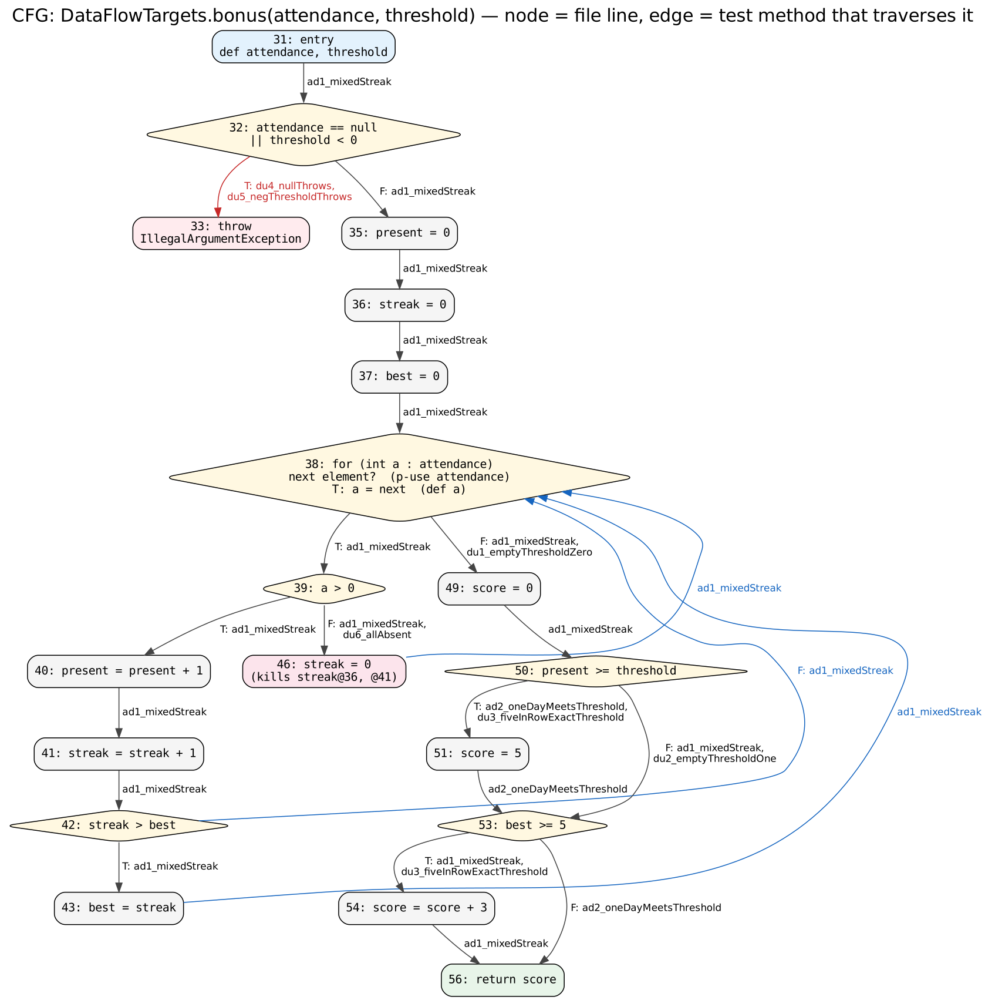

# Лаборатори №10: Өгөгдлийн урсгалын тест — DU хосууд

**Оюутан:** Х.Дэлгэр (Delger Khorolmaa)
**Оюутны код:** B222270835
**Хичээл:** F.CSA313 — Программ хангамжийн чанарын баталгаа ба тест

## Орчин

```
$ java -version
java version "24.0.2" 2025-07-15
Java(TM) SE Runtime Environment (build 24.0.2+12-54)
Java HotSpot(TM) 64-Bit Server VM (build 24.0.2+12-54, mixed mode, sharing)
```

```
$ mvn -version
Apache Maven 3.9.16 (2bdd9fddda4b155ebf8000e807eb73fd829a51d5)
Maven home: C:\tools\apache-maven-3.9.16
Java version: 24.0.2, vendor: Oracle Corporation, runtime: C:\Program Files\Java\jdk-24
Default locale: en_US, platform encoding: UTF-8
OS name: "windows 10", version: "10.0", arch: "amd64", family: "windows"
```

---

## Хэсэг A: gcd — бүрэн DU хүснэгт

Мөрийн дугаар нь `DataFlowTargets.java` файлын дугаар (лекцийн 1→13, 3→15, 4→16, 5→17, 6→18, 8→20).

### Def/Use жагсаалт

| Мөр | Код | Def | c-use | p-use |
|---|---|---|---|---|
| 13 | `gcd(int x, int y)` | x, y | – | – |
| 14 | `int tmp;` | – (утга оноогоогүй зарлалт) | – | – |
| 15 | `while (y != 0)` | – | – | y (15T → 16, 15F → 20) |
| 16 | `tmp = x % y;` | tmp | x, y | – |
| 17 | `x = y;` | x | y | – |
| 18 | `y = tmp;` | y | tmp | – |
| 20 | `return x;` | – | x | – |

### DU хосууд (13 хос)

| # | Хувьсагч | Def мөр | Use мөр | c-use/p-use | Def-clear зам | Тестийн ID | Хамрагдсан |
|---|---|---|---|---|---|---|---|
| 1 | x | 13 | 16 | c-use | 13→15T→16 | T1, T3 | ✔ |
| 2 | x | 13 | 20 | c-use | 13→15F→20 | T2 | ✔ |
| 3 | x | 17 | 16 | c-use | 17→18→15T→16 | T1 | ✔ |
| 4 | x | 17 | 20 | c-use | 17→18→15F→20 | T1, T3 | ✔ |
| 5 | y | 13 | 15T | p-use | 13→15T | T1, T3 | ✔ |
| 6 | y | 13 | 15F | p-use | 13→15F | T2 | ✔ |
| 7 | y | 13 | 16 | c-use | 13→15T→16 | T1, T3 | ✔ |
| 8 | y | 13 | 17 | c-use | 13→15T→16→17 | T1, T3 | ✔ |
| 9 | y | 18 | 15T | p-use | 18→15T | T1 | ✔ |
| 10 | y | 18 | 15F | p-use | 18→15F | T1, T3 | ✔ |
| 11 | y | 18 | 16 | c-use | 18→15T→16 | T1 | ✔ |
| 12 | y | 18 | 17 | c-use | 18→15T→16→17 | T1 | ✔ |
| 13 | tmp | 16 | 18 | c-use | 16→17→18 | T1, T3 | ✔ |

Биелэшгүй хос байхгүй — 13 хос бүгд хамрагдсан.

Тэмдэглэл:
- Мөр 17 (`x = y`) нь x@13-ийг, мөр 18 (`y = tmp`) нь y@13-ийг алдаг (kill). Тиймээс x@13 → 20 болон y@13 → 15F хосууд зөвхөн давталт огт ажиллахгүй үед л def-clear замтай.
- x мөр 17-д хэрэглэгдэхгүй (мөр 17 нь y-г уншдаг), тиймээс x-ийн use мөр 17-д байхгүй.

### Тестүүд (`src/test/java/mn/edu/must/sqat/GcdTest.java`)

| ID | Метод | Оролт → гаралт | Давталт | Хамрах хосууд |
|---|---|---|---|---|
| T1 | `t1_gcd_12_8_twoIterations` | gcd(12, 8) → 4 | 2 | #1, #3, #4, #5, #7–#13 |
| T2 | `t2_gcd_7_0_noIteration` | gcd(7, 0) → 7 | 0 | #2, #6 |
| T3 | `t3_gcd_0_5_oneIteration` | gcd(0, 5) → 5 | 1 | #1, #4, #5, #7, #8, #10, #13 (нэмэлт шалгалт) |

**gcd(7, 0) ганцаараа юуг хамардаг вэ?** y = 0 тул давталт огт ажиллахгүй, зам нь 13→15F→20. Энэ нь x@13 → 20 (#2) болон y@13 → 15F (#6) хосыг хамрах цорын ганц төрлийн тест — давталт нэг ч удаа ажиллавал мөр 17, 18 эдгээр def-ийг алчихна.

**gcd(12, 8) хэдэн давталт хийдэг вэ?** 2 давталт: (12 % 8 = 4 → x = 8, y = 4), (8 % 4 = 0 → x = 4, y = 0), дараа нь 15F → return 4. Давталтын дотор хийсэн def дараагийн эргэлтийн эхэнд хүрэх хосууд — #3 (x17→16), #9 (y18→15T), #11 (y18→16), #12 (y18→17) — хамгийн багадаа **2 давталт** шаарддаг. Нэг давталттай gcd(0, 5) эдгээрийг хамарч чадахгүй.

Иймээс all-DU-pairs-ийг T1 + T2 хоёр тест хангана; T3 нь нэмэлт шалгалт.

---

## Хэсэг B: bonus — бүрэн анализ

### B1 — CFG



Зангилаа бүр файлын мөрийн дугаартай, ирмэг бүрд түүнийг дайрдаг `BonusTest`-ийн методын нэр бичигдсэн. Мөр 38 (for-each): нөхцөл = attendance-д дараагийн элемент байгаа эсэх (attendance-ийн p-use), T салаа = дараагийн элементийг a-д оноох (a-ийн def).

### B2 — Def/Use жагсаалт

```java
31: bonus(int[] attendance, int threshold)  // def: attendance, threshold
32: if (attendance == null || threshold < 0) // p-use: attendance, threshold (32T, 32F)
33:   throw ...                              // –
35: int present = 0;                         // def: present
36: int streak = 0;                          // def: streak
37: int best = 0;                            // def: best
38: for (int a : attendance)                 // p-use: attendance (38T, 38F); def: a (38T алхам)
39:   if (a > 0)                             // p-use: a (39T, 39F)
40:     present = present + 1;               // c-use: present; def: present
41:     streak = streak + 1;                 // c-use: streak;  def: streak
42:     if (streak > best)                   // p-use: streak, best (42T, 42F)
43:       best = streak;                     // c-use: streak;  def: best
46:   else streak = 0;                       // def: streak  (KILL: streak@36, streak@41)
49: int score = 0;                           // def: score
50: if (present >= threshold)                // p-use: present, threshold (50T, 50F)
51:   score = 5;                             // def: score
53: if (best >= 5)                           // p-use: best (53T, 53F)
54:   score = score + 3;                     // c-use: score;   def: score
56: return score;                            // c-use: score
```

Нийт 13 def: attendance@31, threshold@31, a@38, present@35, @40, streak@36, @41, @46, best@37, @43, score@49, @51, @54.

### B3 — DU хүснэгт

| # | Хувьсагч | Def | Use | c/p | Def-clear зам (жишээ) | Тестийн ID | Хамрагдсан |
|---|---|---|---|---|---|---|---|
| B1 | attendance | 31 | 32T | p | 31→32T | du4_nullThrows | ✔ |
| B2 | attendance | 31 | 32F | p | 31→32F | ad1_mixedStreak | ✔ |
| B3 | attendance | 31 | 38T | p | 31→32F→35→36→37→38T | ad1_mixedStreak | ✔ |
| B4 | attendance | 31 | 38F | p | …→38F | ad1_mixedStreak, du1 | ✔ |
| B5 | threshold | 31 | 32T | p | 31→32T (attendance ≠ null) | du5_negThresholdThrows | ✔ |
| B6 | threshold | 31 | 32F | p | 31→32F | ad1_mixedStreak | ✔ |
| B7 | threshold | 31 | 50T | p | …→50T | ad2_oneDayMeetsThreshold | ✔ |
| B8 | threshold | 31 | 50F | p | …→50F | ad1_mixedStreak | ✔ |
| B9 | a | 38 | 39T | p | 38T→39T | ad1_mixedStreak | ✔ |
| B10 | a | 38 | 39F | p | 38T→39F | ad1_mixedStreak | ✔ |
| B11 | present | 35 | 40 | c | 35→36→37→38T→39T→40 | ad1_mixedStreak | ✔ |
| B12 | present | 35 | 50T | p | 35→…→38F→49→50T | du1_emptyThresholdZero | ✔ |
| B13 | present | 35 | 50F | p | 35→…→38F→49→50F | du2_emptyThresholdOne | ✔ |
| B14 | present | 40 | 40 | c | 40→41→42→(43)→38T→39T→40 | ad1_mixedStreak | ✔ |
| B15 | present | 40 | 50T | p | 40→…→38F→49→50T | ad2_oneDayMeetsThreshold | ✔ |
| B16 | present | 40 | 50F | p | 40→…→38F→49→50F | ad1_mixedStreak | ✔ |
| B17 | streak | 36 | 41 | c | 36→37→38T→39T→40→41 | ad1_mixedStreak | ✔ |
| B18 | streak | 41 | 41 | c | 41→42→(43)→38T→39T→40→41 | ad1_mixedStreak | ✔ |
| B19 | streak | 41 | 42T | p | 41→42T | ad1_mixedStreak | ✔ |
| B20 | streak | 41 | 42F | p | 41→42F | ad1_mixedStreak | ✔ |
| B21 | streak | 41 | 43 | c | 41→42T→43 | ad1_mixedStreak | ✔ |
| B22 | streak | 46 | 41 | c | 46→38T→39T→40→41 | ad1_mixedStreak | ✔ |
| B23 | best | 37 | 42T | p | 37→38T→39T→40→41→42T | ad1_mixedStreak | ✔ |
| B24 | best | 37 | 42F | p | — | — | ✘ биелэшгүй |
| B25 | best | 37 | 53T | p | — | — | ✘ биелэшгүй |
| B26 | best | 37 | 53F | p | 37→38F→49→50→53F | du1_emptyThresholdZero | ✔ |
| B27 | best | 43 | 42T | p | 43→38T→39T→40→41→42T | ad1_mixedStreak | ✔ |
| B28 | best | 43 | 42F | p | 43→38T→39F→46→38T→39T→40→41→42F | ad1_mixedStreak | ✔ |
| B29 | best | 43 | 53T | p | 43→…→38F→49→50→53T | ad1_mixedStreak | ✔ |
| B30 | best | 43 | 53F | p | 43→38F→49→50→51→53F | ad2_oneDayMeetsThreshold | ✔ |
| B31 | score | 49 | 54 | c | 49→50F→53T→54 | ad1_mixedStreak | ✔ |
| B32 | score | 49 | 56 | c | 49→50F→53F→56 | du2_emptyThresholdOne | ✔ |
| B33 | score | 51 | 54 | c | 51→53T→54 | du3_fiveInRowExactThreshold | ✔ |
| B34 | score | 51 | 56 | c | 51→53F→56 | ad2_oneDayMeetsThreshold | ✔ |
| B35 | score | 54 | 56 | c | 54→56 | ad1_mixedStreak | ✔ |

**Дүн:** 35 хос, үүнээс 2 биелэшгүй → **33 биелэх хос, 33/33 хамрагдсан.**

#### Мөр 46 (`streak = 0`) ямар def-ийг алдаг вэ (kill)

Мөр 46 нь **streak@36** ба **streak@41**-ийг алдаг. Тиймээс 39F→46 салаагаар дайрсан зам streak-ийн хувьд def-clear биш. streak@36 → 41 (B17) болон streak@41 → 41 (B18) хосууд нь 46-г тойрсон өөр замтай тул DU хос хэвээр; харин 46-ийн дараа ирэх streak-ийн use нь зөвхөн streak@46-ийнх болно.

#### Kill-ээр тасардаг, DU хос гэж ТООЦООГҮЙ хослолууд

- **streak@36 → 42 (T/F), 43** — 42, 43-т хүрэх бүх зам мөр 41-ээр дайрдаг, 41 нь streak-ийг дахин тодорхойлно.
- **streak@46 → 42 (T/F), 43** — мөн адил мөр 41-ээр алагдана.
- **present@35 → 40-ийн дараах use**, **best@37 → 43-ын дараах use** — эхний давталтад 40/43 ажилласны дараа хуучин def алагдсан; ийм use-д зөвхөн шинэ def хүрнэ.
- **streak@41, streak@46 → давталтын гаднах use** — streak давталтын дараа хэрэглэгдэхгүй тул хос үүсэхгүй.

#### Биелэшгүй хосуудын үндэслэл

- **B24 best@37 → 42F:** мөр 42-т зөвхөн мөр 41-ийн дараа ирдэг тул streak ≥ 1, харин best@37 = 0 → `streak > best` анх ирэхэд үргэлж T; T салаа мөр 43-т best-ийг дахин тодорхойлдог тул best@37 хэзээ ч 42F-д хүрэхгүй.
- **B25 best@37 → 53T:** best@37 мөр 53-т хүрэхийн тулд мөр 43 огт ажиллах ёсгүй (ирсэн өдөр байхгүй) → best = 0, `0 >= 5` үргэлж худал.

#### Тэмдэглэл: 32-ын short-circuit

`attendance == null` үнэн бол `threshold < 0` огт үнэлэгдэхгүй. Тиймээс du4 (null) нь threshold-ийн 32T хосыг хамардаггүй — B5-ийг хамрахын тулд attendance ≠ null, threshold < 0 тест (du5) тусдаа хэрэгтэй.

### B4 — Тестүүд (`src/test/java/mn/edu/must/sqat/BonusTest.java`)

#### Шат 1: ALL-DEFS — 2 тест

| Тест | Оролт → гаралт | Юуг хангах вэ |
|---|---|---|
| `ad1_mixedStreak` | {1,0,1,1,1,1,1}, thr=10 → 3 | score@51-ээс бусад 12 def бүгд use-д хүрнэ: эхний ирсэн өдөр (streak@36→41, best@37→42T), тасалсан өдөр (a→39F, streak@46→41), 5 дараалсан ирц (best@43→53T), present = 6 < 10 → 50F тул score@49 → 54, score@54 → 56 |
| `ad2_oneDayMeetsThreshold` | {1}, thr=1 → 5 | score@51 → 53F → 56 |

**Яагаад 1 тест хангалтгүй вэ?** score@49 ямар нэг use-д хүрэхийн тулд мөр 50 ХУДАЛ байх ёстой (үнэн бол мөр 51 score@49-ийг алчихна). Харин score@51 зөвхөн мөр 50 ҮНЭН үед л үүснэ. Нэг гүйцэтгэл мөр 50-д зөвхөн нэг салаагаар явдаг тул score@49 ба score@51-ийг нэг гүйцэтгэлд хоёуланг нь use-д хүргэх боломжгүй → **all-defs-д хамгийн багадаа 2 тест** хэрэгтэй.

Үр дүн (`results/mvn-verify-alldefs.txt`): `Tests run: 5, Failures: 0, Errors: 0, Skipped: 0` (GcdTest 3 + BonusTest 2).

`results/jacoco-alldefs.csv` (DataFlowTargets):

| | MISSED | COVERED |
|---|---|---|
| BRANCH | 2 | 14 (14/16) |
| LINE | 2 | 22 |

All-defs хангагдсан ч **branch 100% биш (14/16)**: мөр 32-ын `attendance == null` ба `threshold < 0` нөхцлүүдийн ҮНЭН салаа хэзээ ч ажиллаагүй. Шалтгаан нь attendance@31, threshold@31 def-үүд 32F салаагаар аль хэдийн use-д хүрсэн тул all-defs 32T-г шаарддаггүй. Line-ийн 2 алдсан мөр нь мөр 33 (`throw`) ба мөр 7 (далд constructor).

#### Шат 2: ALL-DU-PAIRS — 5 тест нэмсэн (+3 нэмэлт шалгалт)

Шат 1-ийн ad1, ad2 нь 35 хосын 26-г хамарсан. Үлдсэн биелэх 7 хосыг хамрахын тулд:

| Тест | Оролт → гаралт | Шинээр хамрах хосууд |
|---|---|---|
| `du1_emptyThresholdZero` | {}, thr=0 → 5 | B12 present@35→50T, B26 best@37→53F |
| `du2_emptyThresholdOne` | {}, thr=1 → 0 | B13 present@35→50F, B32 score@49→56 |
| `du3_fiveInRowExactThreshold` | {1,1,1,1,1}, thr=5 → 8 | B33 score@51→54 |
| `du4_nullThrows` | null, thr=0 → IllegalArgumentException | B1 attendance@31→32T |
| `du5_negThresholdThrows` | {}, thr=-1 → IllegalArgumentException | B5 threshold@31→32T |

Нэмэлт шалгалт (лабын тестийн санаанууд, шинэ хос нэмэхгүй): `du6_allAbsent` ({0,0,0}, 1 → 0 — бүгд тасалсан), `du7_longStreakBrokenInMiddle` ({1,1,1,0,1,1,1,1,1,1}, 9 → 8 — урт цуваа дунд нь тасарч, дараа нь 5-аас урт цуваа), `du8_fourInRowNoStreakBonus` ({1,1,1,1}, 4 → 5 — 4 дараалсан нь +3 авахад 1 дутуу).

Ингэснээр биелэх **33/33 DU хос** хамрагдсан (хүснэгтийн "Тестийн ID" баганыг үз). Тестийн нийт тоо, JaCoCo-гийн эцсийн тоо нь Хэсэг C-гийн дараах `results/mvn-verify-final.txt`, `results/jacoco-final.csv`-д байна.
